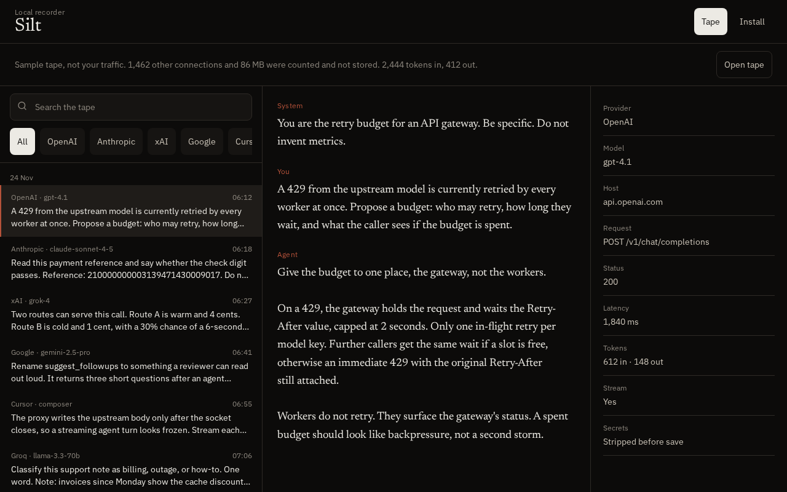
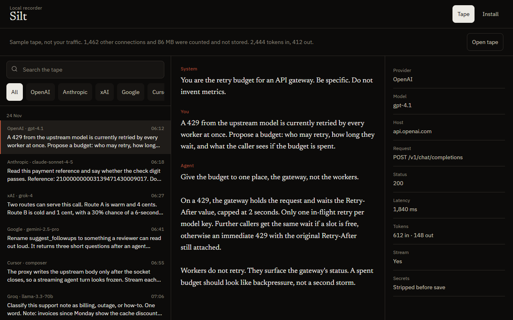
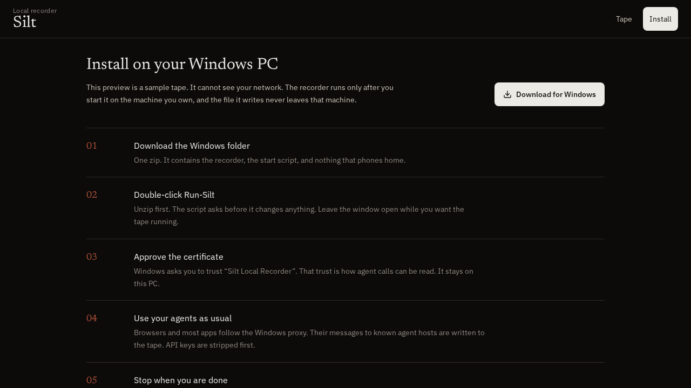

<div align="center">


# Silt

**The local-first flight recorder for AI coding agents on Windows.**

Inspect every prompt, system instruction, tool call, reply, and token count your machine sends to AI agents—without sending your traffic to a cloud observability service or writing a single API key to disk.

[](LICENSE)
[](#quick-start-windows-recorder)
[](#web-desk--development)
[](#limitations--privacy-boundaries)
[](https://github.com/omgapnt/silt/releases/latest)

[Why Silt?](#why-silt) · [Supported Agents & APIs](#supported-agents--providers) · [Quick Start](#quick-start-windows-recorder) · [Architecture](#architecture) · [JSONL Schema](#tape-format-capturesjsonl)

</div>

---



---

## Why Silt?

Modern AI coding tools (**Claude Code**, **Cursor**, **Codex**, **Gemini CLI**, **GitHub Copilot**, **Cline**, **Aider**) assemble massive prompts, inject hidden context, and fire background requests that are invisible in your terminal or editor UI.

Existing LLM observability tools typically ask you to route your API calls through a third-party cloud proxy—handing over your proprietary source code and API keys.

**Silt takes the opposite approach:**

- **100% Loopback & Zero Telemetry** — Runs strictly on `127.0.0.1:8877` and writes an append-only tape to `%LOCALAPPDATA%\Silt\captures.jsonl`. Nothing ever leaves your PC.
- **Selective TLS Inspection** — Only opens HTTPS traffic to known AI agent hosts (plus any private gateways you explicitly list). Everyday browsing, banking, and non-AI traffic is blind-tunneled without inspection.
- **Secrets Stripped Before Save** — Drops `Authorization` headers, cookies, and session tokens, and automatically scrubs inline keys (`sk-*`, `sk-ant-*`, `Bearer` tokens, `api_key` values) into `«redacted»` before writing to disk.
- **Zero-Config CLI & IDE Trust** — Automatically configures the Windows WinINET proxy **and** user-level CA environment variables (`HTTP_PROXY`, `HTTPS_PROXY`, `NODE_USE_ENV_PROXY=1`, `NODE_EXTRA_CA_CERTS`, `SSL_CERT_FILE`, `REQUESTS_CA_BUNDLE`) so Node, Bun, and Python CLI agents work immediately.
- **Guaranteed Clean Restore** — Snapshots your prior proxy and environment state before starting and restores everything cleanly when closed or when `Stop-Silt.cmd` runs.

---

## Supported Agents & Providers

Silt recognizes over **55 built-in AI endpoints** out of the box across CLI agents, AI IDEs, desktop apps, and direct API calls:

| Category | Supported Tools & Endpoints |
| :--- | :--- |
| **Coding CLIs & IDEs** | **Claude Code**, **Cursor** (`*.cursor.sh`, `api.cursor.com`), **GitHub Copilot** (`*.githubcopilot.com`), **OpenAI Codex**, **Gemini CLI & Code Assist**, **Qwen Code**, **Cline** (`api.cline.bot`), **opencode**, **Aider**, **Lovable** |
| **Frontier Model APIs** | **Anthropic** (`api.anthropic.com`), **OpenAI** (`api.openai.com`), **xAI / Grok** (`api.x.ai`, `grok.com`), **Google Gemini & Vertex AI** (`generativelanguage.googleapis.com`, `*-aiplatform.googleapis.com`), **DeepSeek**, **Mistral**, **Cohere**, **Moonshot / Kimi** |
| **Inference & Routers** | **OpenRouter** (`openrouter.ai`), **Groq** (`api.groq.com`), **Together AI**, **Fireworks AI**, **Perplexity**, **Hugging Face Inference**, **Replicate**, **Ollama Cloud** |
| **Cloud & Enterprise** | **Azure OpenAI** (`*.openai.azure.com`), **AWS Bedrock** (`bedrock-runtime.*.amazonaws.com`), plus **Custom / Self-Hosted Gateways** via `%LOCALAPPDATA%\Silt\hosts.txt` |

---

## Live Desk & Tape Reader

Silt includes both a live local desk (`http://127.0.0.1:8878` while recording) and a full-featured web tape reader (`src/`) where you can drop any `captures.jsonl` file for offline analysis:

| Live Recorder Desk (`127.0.0.1:8878`) | Windows Installer & Setup Guide |
| :---: | :---: |
|  |  |

---

## Architecture

```text
┌───────────────────────────┐
│  Browsers / IDEs / CLIs   │  (Claude Code, Cursor, Codex, Gemini CLI, Desktop Apps)
└─────────────┬─────────────┘
              │  127.0.0.1:8877 (HTTP/HTTPS Proxy)
              ▼
┌───────────────────────────┐
│    Silt Local Recorder    │  agent/silt-agent.mjs
├───────────────────────────┤
│ • Known AI Host?          │──► No  ──► Blind TCP tunnel (bytes counted, body unopened)
│   Yes                     │
│   ▼                       │
│ • Strip Auth & API Keys   │
│ • Parse SSE / JSON turns  │
└──────┬─────────────┬──────┘
       │             │
       ▼             ▼
  captures.jsonl   Local Desk UI (127.0.0.1:8878)
```

### Repository Structure

| Path | Description |
| :--- | :--- |
| [`agent/`](agent/) | Standalone Windows local proxy (`silt-agent.mjs`), PowerShell setup/restore scripts (`Start-Silt.ps1`, `Stop-Silt.ps1`), launchers (`Run-Silt.cmd`, `Stop-Silt.cmd`), and self-tests (`self-test.mjs`). |
| [`src/`](src/) | React 19 + TanStack Start web application featuring the Silt Tape Desk (`src/components/silt/desk.tsx`), JSONL tape parser, sample session, and Windows setup guide. |
| [`public/silt-windows.zip`](public/silt-windows.zip) | Distributable Windows recorder bundle served directly from the web app and attached to GitHub Releases. |
| [`scripts/`](scripts/) | Build, environment, and browser verification utilities. |

---

## Quick Start (Windows Recorder)

1. **Download [`silt-windows.zip`](https://github.com/omgapnt/silt/releases/latest)** (or use the [`agent/`](agent/) directory directly) on a Windows PC you own.
2. **Start the recorder** by double-clicking `Run-Silt.cmd`.
3. **Approve the local certificate** when Windows asks you to trust **Silt Local Recorder**. The root CA is generated locally on your machine under `%LOCALAPPDATA%\Silt\`.
4. **Use your AI agents as usual.** Restart open terminals or IDEs (such as VS Code or Cursor) that were launched before Silt so they pick up the proxy environment variables.
5. **Inspect your live tape** at `http://127.0.0.1:8878`, or open `%LOCALAPPDATA%\Silt\captures.jsonl` in the web reader.
6. **Stop recording** at any time by closing the Silt window or running `Stop-Silt.cmd`. Your original proxy settings and environment variables are restored automatically.

### Adding Custom or Enterprise Gateways

To record calls sent to a private or self-hosted LLM gateway:

1. Copy [`agent/hosts.example.txt`](agent/hosts.example.txt) to `%LOCALAPPDATA%\Silt\hosts.txt`.
2. Add one hostname or domain suffix per line (e.g., `llm-gateway.internal` or `.corp-llm.example`).
3. Restart Silt.

---

## Web Desk & Development

The web application provides an offline-capable `.jsonl` tape viewer and hosts the downloadable Windows package.

### Prerequisites

- **Node.js** 22+
- **npm**

### Commands

```bash
# Install dependencies
npm install

# Start the development server on 0.0.0.0:8080
npm run dev

# Type-check the project
npm run typecheck

# Run unit and agent self-tests
npm test
node agent/self-test.mjs

# Build for production
npm run build
```

---

## Tape Format (`captures.jsonl`)

Each line in `captures.jsonl` is a standalone JSON object adhering to the `Capture` schema ([`src/lib/silt/types.ts`](src/lib/silt/types.ts)):

```json
{
  "id": "cap_01",
  "at": "2026-03-30T14:22:10.120Z",
  "provider": "Anthropic",
  "host": "api.anthropic.com",
  "method": "POST",
  "path": "/v1/messages",
  "status": 200,
  "model": "claude-sonnet-4-20250514",
  "latencyMs": 1840,
  "streaming": true,
  "requestMessages": [
    { "role": "user", "text": "Summarize the proxy restore logic in Start-Silt.ps1." }
  ],
  "responseText": "Start-Silt.ps1 backs up HKCU Internet Settings and user environment variables...",
  "usage": { "input": 412, "output": 198 },
  "bytesIn": 1540,
  "bytesOut": 2890,
  "secretsStripped": true
}
```

---

## Limitations & Privacy Boundaries

- **Certificate Pinning:** Applications that enforce strict certificate pinning refuse proxy inspection; Silt automatically passes those hosts through unread so they never break.
- **Local Models:** Traffic to `localhost` / `127.0.0.1` (such as Ollama or LM Studio running locally) bypasses the Windows system proxy by design.
- **Firefox:** Firefox uses its own certificate store unless configured to trust Windows root certificates or until `%LOCALAPPDATA%\Silt\silt-ca.cer` is imported in Firefox settings.

---

## License

Released under the [MIT License](LICENSE).
